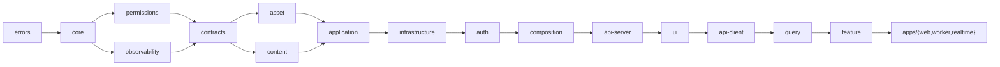

<div align="center">

# loadbearing lite

**The big kit with the scale stores removed and every seam kept.**

TanStack Start + oRPC · standalone worker · realtime stream process · Postgres + pgvector ·<br>
one Redis (cache + queue) · S3 · logs to stdout

<br>


</div>

> [!NOTE]
> This is **lite**, cut from the big kit **[loadbearing](https://github.com/sami999khan999/loadbearing_large)**:
> same packages, `@loadbearing/*` scope and rules. [`UPSTREAM.md`](UPSTREAM.md) records the cut
> commit; [`docs/scale/`](docs/scale/index.md) is the way back to each removed piece.

## ✦ Highlights

- **🧱 Layered, port-and-adapter packages** — sixteen `@loadbearing/*` packages, dependencies one way;
  the domain names no framework and never logs, enforced by CI.
- **🗄️ Small today, ready to shard** — one node runs, but every tenant table is partitioned by
  `organization_id`, every repository declares its placement, every connection is written for
  pgBouncer.
- **🔐 Auth, RBAC and entitlements** — Better Auth sessions, organizations with four system roles,
  per-plan entitlements and feature flags, all enforced on the server.
- **📬 One send path** — every mail is a BullMQ job the worker renders and sends with retries,
  backoff and a rate limiter; never from inside a request.
- **🎨 Six themes, twelve colours** — `pnpm check contrast` checks 154 pairings against WCAG AA.
- **🛡️ 31 architecture assertions** — `pnpm check architecture` catches what typecheck, lint and tests
  miss.

| Layer | Choice |
|---|---|
| **Web** | TanStack Start · React 19 · Tailwind 4 · oRPC |
| **Processes** | `apps/web` · `apps/worker` · `apps/realtime` |
| **Database** | Postgres + pgvector · Drizzle ORM · one node, dialled directly |
| **Cache & queue** | One Redis under `noeviction`, still read through two env names · BullMQ |
| **Storage** | S3 (MinIO locally) |
| **Logs** | JSON to stdout |
| **Search** | Postgres full-text by default; OpenAI or Gemini embeddings when switched on |
| **Mail** | SMTP, caught by Mailpit in development |
| **Copy** | `@loadbearing/content`, in English and Bangla |

## ✦ Architecture

A package imports from its left, never its right:



`application` is the domain (no framework, no logging); `infrastructure` is organised by vendor
(`pg/`, `redis/`, `s3/`, `smtp/` …), so a swap deletes one folder; `composition` is the DI root, the
only place an adapter is named; `apps/*` are thin and deletable. Full rules:
[`docs/ai/rules/layering.md`](docs/ai/rules/layering.md).

## ✦ Quick start

> **Requirements:** Node ≥ 24, pnpm ≥ 11.21, Docker running.

```bash
pnpm install
node -e "require('fs').copyFileSync('.env.example', '.env')"   # then set AUTH_SECRET
pnpm infra up                                                  # the whole local stack
pnpm db migrate && pnpm seed:dev
pnpm dev                                                       # web + worker + realtime
```

Open **http://localhost:23000/sign-up**; the verification mail lands in Mailpit at
**http://localhost:28025**.

- **`.env`:** copy the template whole — `apps/web/src/env.ts` parses the full schema at load, so a
  missing key fails boot. Set a real `AUTH_SECRET` (`openssl rand -hex 32`); `change-me` is too
  short. Search needs no key: `EMBEDDING_PROVIDER=none` is Postgres full-text, `openai` or `gemini`
  switch to embeddings ([reference/embedding](packages/infrastructure/docs/reference/embedding.md)).
- **Ports** are the well-known ones with a `2` in front (`POSTGRES_PORT` `REDIS_PORT` `S3_PORT`
  `MINIO_CONSOLE_PORT` `SMTP_PORT` `MAILPIT_UI_PORT` `WEB_PORT`), all in the root `.env`. Change a
  `*_PORT` and the URL dialling it together — `check architecture` §27 fails if they disagree. For the
  web app change `WEB_PORT`, and `APP_BASE_URL`, `AUTH_URL` and `AUTH_TRUSTED_ORIGINS` with it.
- **Infrastructure:** five containers — Postgres + pgvector, one Redis (`noeviction`, since it holds
  the queue), MinIO with its one-shot bucket init, Mailpit. Wait for `node tooling/scripts/compose.mjs
  ps` to show healthy. See [`docs/infra/`](docs/infra/index.md).
- **`seed:prod`** creates the `loadbearing` platform organization, its roles, and a docs space per
  docs tree (read by platform staff at `/doc`). **`seed:dev`** adds a verified platform admin,
  `admin@loadbearing.test`, and prints its password once (`ADMIN_PASSWORD` sets one). Every other
  task is `pnpm ops <task>`; `pnpm ops` alone lists them.

| Service | Address |
|---|---|
| 🌐 Web app | http://localhost:23000 |
| 📬 Mailpit | http://localhost:28025 |
| 🪣 MinIO console | http://localhost:29001 |
| 💓 Readiness probe | http://localhost:23000/api/health |
| 🗃️ Drizzle Studio | `pnpm db studio` |

> [!IMPORTANT]
> Every message is a job on `QueueName.MAIL`, so **nothing reaches Mailpit unless the worker runs**
> (`pnpm dev` starts it). See [`mail-pipeline.md`](packages/composition/docs/reference/mail-pipeline.md).

## ✦ Accounts and organizations

**No session is issued without a membership**; `AUTH_ENROLMENT_MODE` decides how you get one:

| Mode | What happens on sign-up |
|---|---|
| `personal` *(default)* | You become `owner` of a new organization with the four system roles. The only mode that works on an empty database. |
| `bootstrap` | Everyone joins the organization `BOOTSTRAP_ORGANIZATION_SLUG` names; the first becomes `owner`. |
| `invite` | Invitation only — the production posture. |

A pending invitation always wins. To try the gates: invite a second address from `/settings/members`
and accept in another browser profile — that `member` is sent to `/forbidden` from `/settings/roles`.

## ✦ Before committing

```bash
pnpm check architecture   # needs pnpm build:packages + a web build, or two assertions skip
pnpm typecheck && pnpm lint && pnpm test
```

| Symptom | Cause |
|---|---|
| 500 on the first request, `ZodError` naming env keys | `.env` missing or incomplete |
| `/api/health` returns 503 | A container is down, or a `.env` URL names the wrong host port |
| `ECONNREFUSED` from `db migrate` | Postgres not healthy yet, or the port is taken |
| Signed up, still signed-out | No membership — `bootstrap` without seed/slug, or `invite` with no invitation |

## ✦ Big kit vs lite

Same packages, scope and rules; different stores running.

| | **[loadbearing](https://github.com/sami999khan999/loadbearing_large)** | **loadbearing lite** *(this repo)* |
|---|---|---|
| Postgres | pgBouncer · read replica · shard nodes | one node, dialled directly |
| Redis | two instances, cache and queue | one instance, `noeviction` |
| Logs | stdout → Alloy → Loki | stdout |
| Analytics | ClickHouse, behind a flag | not built |
| Retention | archive-then-drop to S3 `cold/` | partitions kept, never dropped |
| Widgets and zones | ✅ | not built |
| Seams | ✅ all built | ✅ all built |
| Host ports | `1xxxx` | `2xxxx` |

**What lite leaves out, it keeps ready:** tables stay tenant-partitioned, repositories keep their
shard placement, and `DATABASE_URL` is written as if a pooler sat in front. Each store comes back by
its page in [`docs/scale/`](docs/scale/index.md).

## ✦ Documentation

| Where | What it is |
|---|---|
| **[`AGENTS.md`](AGENTS.md)** | The brief every coding agent reads first, with the whole rulebook; `CLAUDE.md` imports it. |
| **[`docs/ai/`](docs/ai/index.md)** | For agents: a task router, the [rulebook](docs/ai/rules/index.md) and the [run books](docs/ai/skills/index.md) agents load as skills. |
| **[`docs/opinions/`](docs/opinions/index.md)** | The reference: what to call a thing, where it goes, which store owns it. |
| **`packages/*/docs/`** | Per package: what it is for, and why each export is shaped as it is. |
| **[`docs/infra/`](docs/infra/index.md)** | The running stack and what to check when it is wrong. |
| **[`docs/scale/`](docs/scale/index.md)** | What lite removed, when you need it back, and how to port it. |
| **[`docs/plans/`](docs/plans/index.md)** | The backlog of what is left, and the handoff. |
| **[`docs/explained/`](docs/explained/index.md)** | A plain-language guide for newcomers. |

<div align="center">
<sub>Built to carry weight. ⚙️</sub>
</div>
